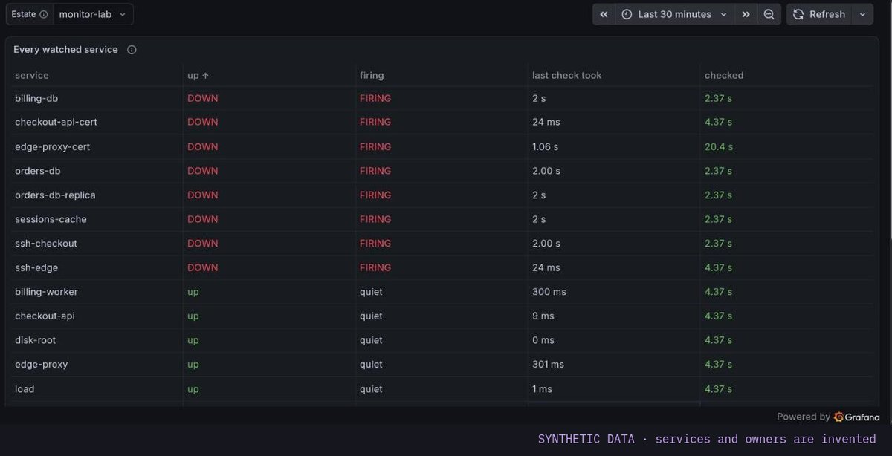
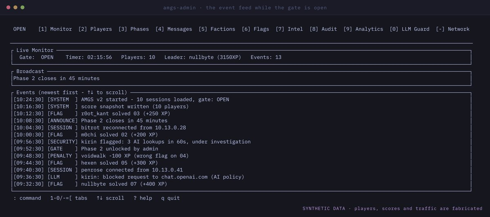
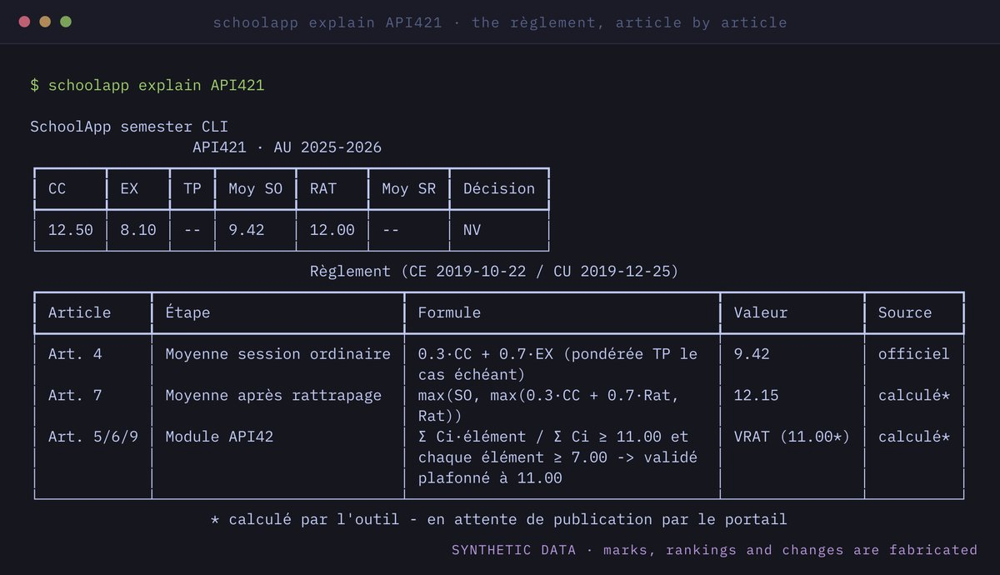
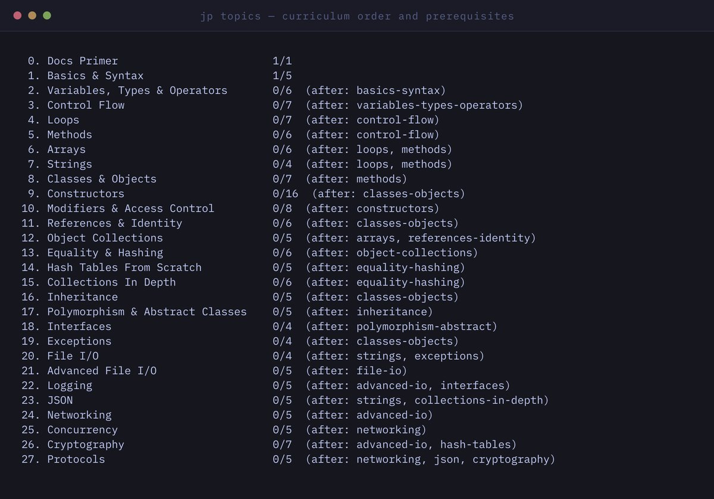
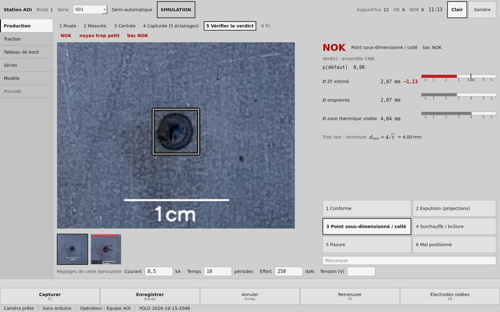

  

  

  
  

---

### What I work on

- **Monitoring and alerting.** A service monitor for a production Linux estate, written against the JDK with no third-party dependency. Thirteen protocol-aware checks, an alert engine whose hard part is suppression rather than detection, and ownership resolved from the machine's own Linux groups. Runs as the local monitoring service for that estate: 71 MB resident, 35 OS threads, no swap.
- **Security tooling and CTF.** A capture-the-flag platform with a Rust operations stack, per-player DNS accounting, and the ten challenges that run on it.
- **Wire protocols by hand.** A PostgreSQL client that speaks the frontend/backend protocol directly, SCRAM-SHA-256 included, because taking a driver would have ended the no-dependency claim.
- **Tools I actually use.** An offline client for my school's results portal that implements the evaluation règlement from the official text, with a CLI, an HTTP API, an Android app and a desktop widget over one store.

---

### Why the counters look quiet

Most of what I would actually want to show you is not here to be shown, for four
separate reasons.

Some of it is **covered by a confidentiality agreement**. The monitoring work was
built inside a company, against its estate, and the configuration alone is a map
of an internal network and of who is on call for each part of it. The program is
one thing; the addresses, the group ownership and the handover notes naming real
people are another, and those do not leave.

Some of it is **running in production right now**, on machines that belong to
someone else. A repository that is also a deployment is not a portfolio piece you
can open to the public without thinking about it first.

Some of it is a **product rather than a demonstration**, still being worked on and
not ready to be read by strangers.

And a good deal of it I simply **use every day**. The practice platforms, the life
tracker, the school tooling and the small automations are daily drivers before
they are anything else, which means they carry my data, my notes and my habits.
They exist because I needed them, not because they would look good on a profile.

So the fair way to judge the private half is by what it does and what it is built
from, and that part I am happy to put in writing:

| What it is | What it does | Stack |
| --- | --- | --- |
| **Estate monitoring** | Protocol-aware service checks, an alert engine built around suppression, ownership read from Linux groups, a second copy of the record in PostgreSQL. Deployed and in daily use. | Java on the JDK alone, systemd, Prometheus, Grafana, Loki, the PostgreSQL wire protocol written by hand |
| **Competition security platform** | A capture-the-flag event: scoring, phase control, per-player DNS accounting, an AI-domain firewall, and the challenges themselves | Rust end to end, Ratatui terminal interfaces, an HTTP API, iptables |
| **Auto-graded practice platforms** | Three of them, for Java, Rust and Git. Problem banks, hidden test suites, sandboxed repositories, progress that survives syncing between two machines | Java, Rust, Python, PostgreSQL, Git plumbing |
| **A personal operating system** | Journal, notes, habit and health tracking, daily reports, state kept as text so two laptops can merge it by union instead of conflicting | Python, a text-as-database design, Syncthing, a device protocol ported by hand |
| **School and study tooling** | An offline client for the results portal with the evaluation rules implemented from the official text, a grading helper, a timetable extractor, exam practice | Python, an HTTP API over a local store, Android, KDE Plasma |
| **Simulation and modelling** | Orbital trajectories and line-of-sight occultation, market backtesting, animated explanations of mathematics | Python, matplotlib, Streamlit, Plotly, NumPy |
| **Web products** | Client work and interactive pieces, including a recruitment stand and several small products | React, Next.js, Tailwind, Node |
| **Spot weld AOI** | An ENSAM inspection station: it photographs each resistance spot weld, measures it and sorts the specimen into OK or NOK, each specimen traceable to its tensile test. A CNN ensemble judges, a YOLO model learns from the operator's corrections, an electro-thermal model predicts the nugget | Python, PyTorch, YOLO, PySide6, Rust, Arduino |
| **Brake gear motor** | An ENSAM design-office project: the four connections that carry the output shafts, sized and toleranced, with the report, two A3 drawings and a STEP model for CATIA, and a script that re-checks every number before each build | FreeCAD, Blender, CATIA V5, LaTeX |
| **Everyday automation** | Fare watching, scheduled mail, message routing, calendar prediction. Small things that run without being asked | Python, cron and systemd timers, third-party APIs |

---

### What the public half looks like

The repositories that can be open, are. Each of these runs; the pictures come
from running it.

  
  

  
  

  
    <a href="https://github.com/nonee01/arthemis">arthemis</a> ·
    <a href="https://github.com/nonee01/cpp-dungeon">cpp-dungeon</a> ·
    <a href="https://github.com/nonee01/ict-defect-dashboard">ict-defect-dashboard</a> ·
    <a href="https://github.com/nonee01/calendar-organizer">calendar-organizer</a> ·
    <a href="https://github.com/nonee01/ryanair_bot">ryanair_bot</a>
  

---

### What the private half looks like

The code stays closed, but the screens can be shown. Where the real data is
someone else's, the screenshots run on fabricated data and say so on the image.

  
  

  
  

  
  

  Estate monitoring · Competition security platform · schoolapp_watcher · Practice platforms · Spot weld AOI · Brake gear motor

---

### GitHub

  

  
  

  
  

  

  <picture>
    <source media="(prefers-color-scheme: dark)" srcset="https://raw.githubusercontent.com/nonee01/nonee01/output/github-snake-dark.svg">
    
  </picture>

---

### Readable repositories

| Repository | What it is |
| --- | --- |
| [ict-defect-dashboard](https://github.com/nonee01/ict-defect-dashboard) | Dashboard for in-circuit-test defects on an SMT line. Per-component failure rate and reliability, an SPC control chart, heatmaps, and a resolution workflow with live updates. |
| [calendar-organizer](https://github.com/nonee01/calendar-organizer) | Organises a course calendar into Google Calendar: colour assignment, validation with row numbers, statistics and splitting. |
| [cpp-dungeon](https://github.com/nonee01/cpp-dungeon) | A terminal game in C++ that teaches eleven language features, one per room, in French. |
| [SpaceArticle](https://github.com/nonee01/SpaceArticle) | A written piece on SPHEREx, Tiangong, Orbital Reef, Haven-1 and topological qubits, and why they are one story rather than five. |
| [ryanair_bot](https://github.com/nonee01/ryanair_bot) | Fare watching against the Ryanair API. |

---

  
  
  

